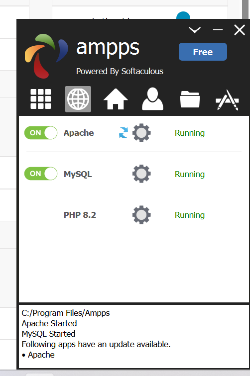
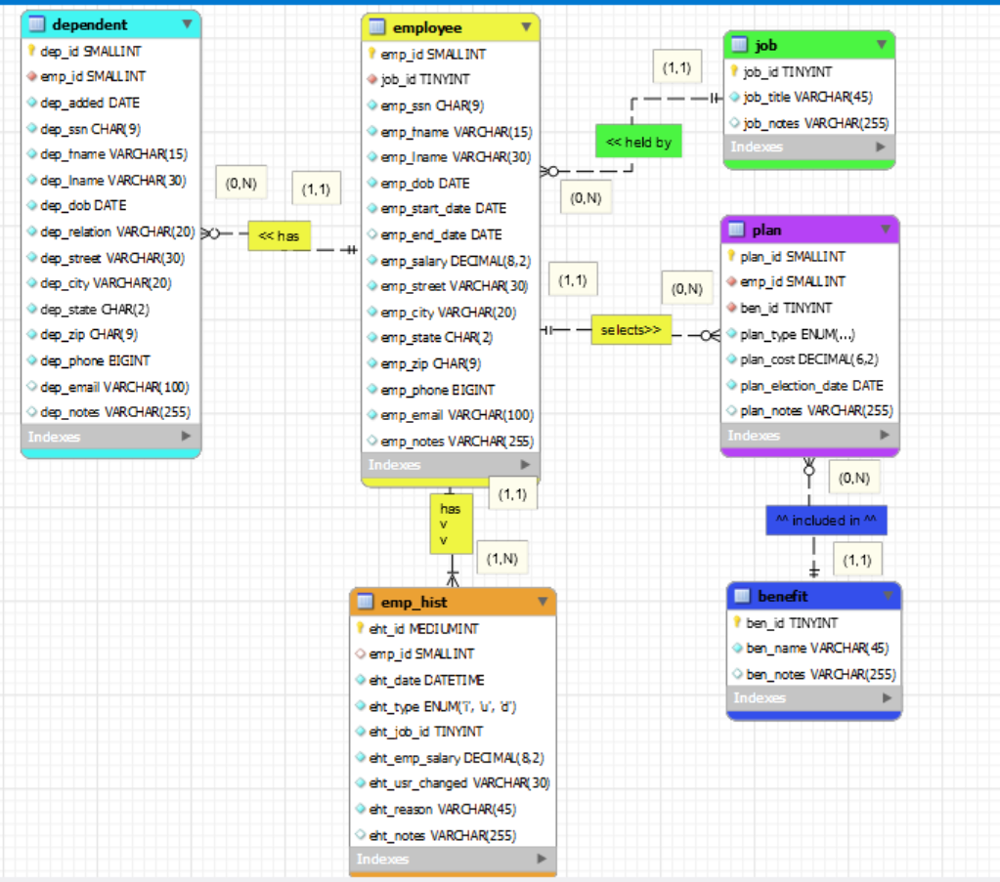
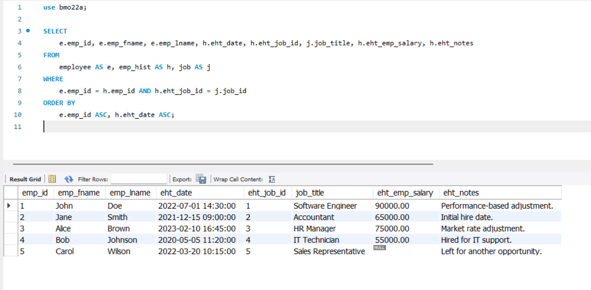

# LIS4368 Advanced Database Management

## Brennan O'Halloran

# Assignemnt 1 Requirements:

Five Parts:

1. Distributive version control with Git and BitBucket.
2. Install Ampps software.
3. Answer required questions
4. ERD and SQL code 
5. Bitbucket repo links

# A1 Database Business Rules

The human resource (HR) department of the ACME company wants to contract a database modeler/designer to collect the following employee data for tax purposes: job description, length of employment, benefits, number of dependents and their relationship, and DOB of both the employee and any respective dependents. In addition, employees' histories must be tracked. Also, include the following business rules:

- Each employee may have one or more dependents.
- Each employee has only one job.
- Each job can be held by many employees.
- Many employees may receive many benefits.
- Many benefits may be selected by many employees (though, while they may not select any benefits—any dependents of employees may be on an employee's plan).
- Employee/Dependent tables must use suitable attributes (See Assignment Guidelines).

### In Addition:

- **Employee:** SSN, DOB, start/end dates, salary.
- **Dependent:** Same information as their associated employee (though, not start/end dates), date added (as dependent), type of relationship (e.g., father, mother, etc.).
- **Job:** Title (e.g., secretary, service tech, manager, cashier, janitor, IT, etc.).
- **Benefit:** Name (e.g., medical, dental, long-term disability, 401k, insurance, etc.).
- **Plan:** Type (single, spouse, family), cost, election date (plans must be tracked by value).
- **Employee history:** Jobs, salaries, and benefit changes, as well as who made the change and why.
- **Zero Filled data:** SSN, zip codes (not phone numbers; US area codes below 201, NJ).
- **All tables must include a notes attribute.**

#### README.md file should include the following items:

* Screenshot of A1 ERD
* At least 1 SQL Solution
* Forward Engineered SQL file [Download a1SQL](lis3781_a1_solutions.sql)

* Git commands and short descriptions

> #### Git commands w/short descriptions:

1. git init - Create an empty Git repository or reinitialize an existing one
2. git status - Show the working tree status
3. git add - Add file contents to the index
4. git commit - Record changes to the repository
5. git push - Update remote refs along with associated objects
6. git pull - Fetch from and integrate with another repository or a local branch
7. git clone - Clone a repository into a new directory

#### Assignment Screenshots:

*Screenshot of AMPPS running http://localhost*:

*Screenshot of a1 ERD*:

*Screenshot of Question 2 Solution*:

#### Tutorial Links:

*Bitbucket Tutorial - Station Locations:*
[A1 Bitbucket Station Locations Tutorial Link](https://bitbucket.org/username/bitbucketstationlocations/ "Bitbucket Station Locations")
