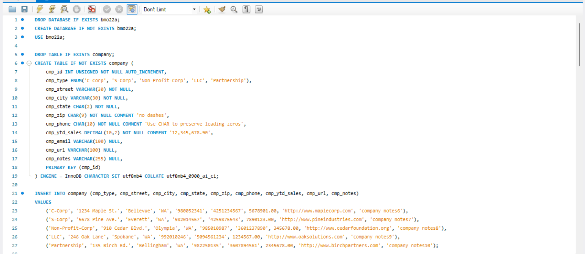
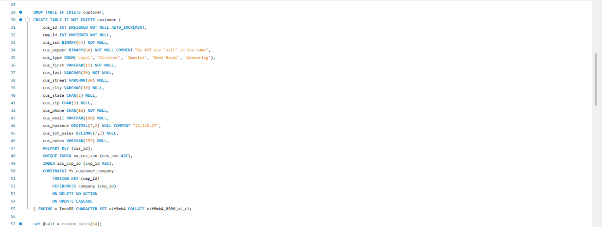
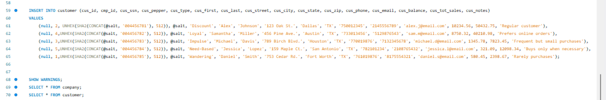
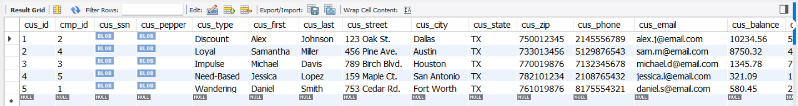
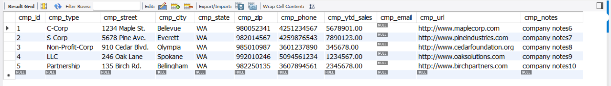
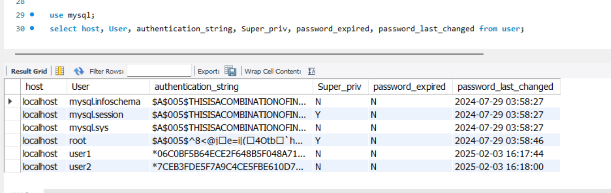

# LIS3781 Advanced Database Management  

## Brennan O'Halloran  

### Assignment #2 Requirements  

---  

**Five Parts:**

1. Create SQL tables and insert data.
2. Grant privileges to users.
3. Test user permissions.
4. Attach required screenshots.
5. Bitbucket repo links

### Database Design  

#### a. Use 1:M Relationship  
- Company is the parent table  

#### b. Company Table Attributes  
- cmp_id (Primary Key)  
- cmp_type ENUM('C-Corp', 'S-Corp', 'Non-Profit-Corp', 'LLC', 'Partnership')  
- cmp_street  
- cmp_city  
- cmp_state  
- cmp_zip  
- cmp_phone  
- cmp_ytd_sales  
- cmp_url  
- cmp_notes  

#### c. Customer Table Attributes  
- cus_id (Primary Key)  
- cmp_id (Foreign Key)  
- cus_ssn (BINARY 64)  
- cus_salt (BINARY 64)  
- cus_type ENUM('Loyal', 'Discount', 'Impulse', 'Need-Based', 'Wandering')  
- cus_first  
- cus_last  
- cus_street  
- cus_city  
- cus_state  
- cus_zip  
- cus_phone  
- cus_email  
- cus_balance  
- cus_tot_sales  
- cus_notes  

#### d. Create Suitable Indexes and Foreign Keys  
- Enforce primary key (PK) and foreign key (FK) relationships  
- `ON UPDATE CASCADE`  
- `ON DELETE RESTRICT`  

#### **Admin Requirements:**  
> **Note:** You do not have permissions to create users on the CCI Server.  

- Create two different users (`user1` and `user2`) with different passwords.  
- Both users can access from localhost only.  
- See **Granting_Privileges.pdf** for reference.  

#### **Permission Requirements:**  
1. User1 permissions: 
   - `SELECT`, `UPDATE`, and `DELETE` privileges on `company` and `customer` tables.  
2. User2 permissions: 
   - `SELECT` and `INSERT` privileges on the `customer` table only.  

#### **Verification Steps:**  
- Log into the local server and verify:  
  - Database/table permissions, show grants for:  
    - Admin account  
    - User1 (logged in as `user1`)  
    - User2 (logged in as `admin`)  
  - Display current user2 and MySQL version.  
  - List tables (as admin).  
  - Display structures for both tables (as admin):  
    - `Company` table  
    - `Customer` table  
  - Display data for both tables:  
    - `Company` (as `user2`)  
    - `Customer` (as `user1`)  

---

### README.md Requirements  

✔️ **Screenshot of your SQL code**  
✔️ **Screenshot of your populated tables**  
✔️ **Link to your `lis3781_a2_solutions.sql` file**  

---

### Assignment Screenshots!  

#### **SQL Code Examples**  
  
  
  

#### **Populated Tables**  
##### **Customer Table:**  
  

##### **Company Table:**  
  

##### **Created Users:**  
  

#### **Solution File**  
📄 [**View lis3781_a2_solutions.sql**](lis3781_a2_solutions.sql)  
