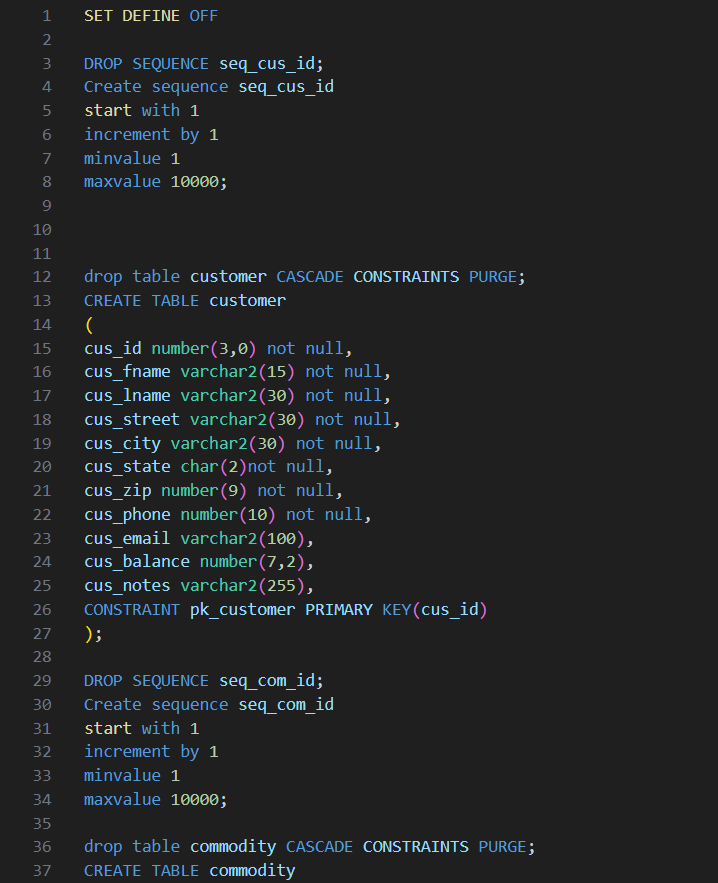
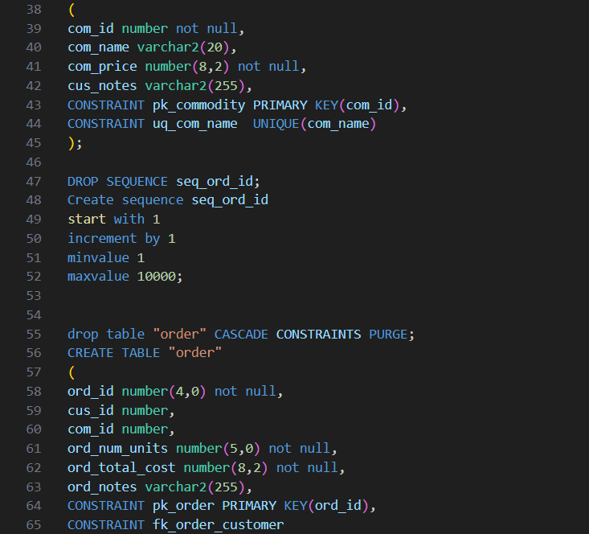
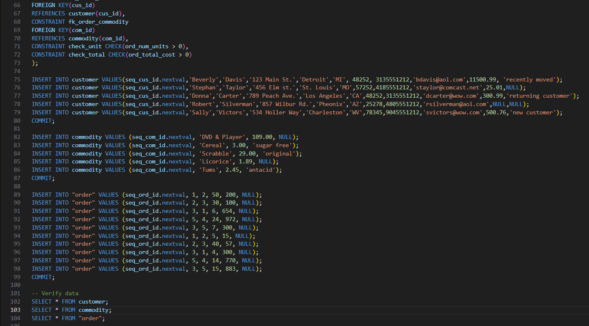
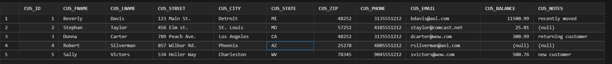
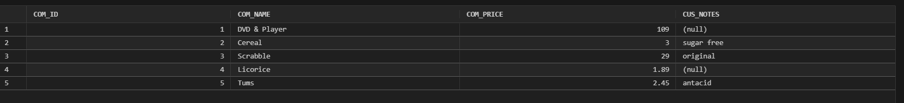
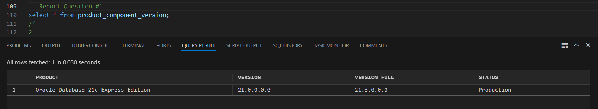

# LIS3781 Advanced Database Management  

## Brennan O'Halloran  

### Assignment #3 Requirements  

---  

**Five Parts:**

1. Create SQL tables and insert data.
2. Grant privileges to users.
3. Test user permissions.
4. Attach required screenshots.
5. Bitbucket repo links

---

### README.md Requirements  

✔️ **Screenshot of your SQL code**  
✔️ **Screenshot of your populated tables**  
✔️ **Screenshot of one required report**  
✔️ **Link to your `lis3781_a3_solutions.sql` file**  

---

### Assignment Screenshots!  

#### **SQL Code Examples**  
  
  
  

---

#### **Populated Tables**  
##### **Customer Table:**  
  

##### **Commodity Table:**  
  

##### **Required Report Question #1:**  
  

#### **Solution File**  
📄 [**View lis3781_a2_solutions.sql**](lis3781_a3_solutions.sql)  
