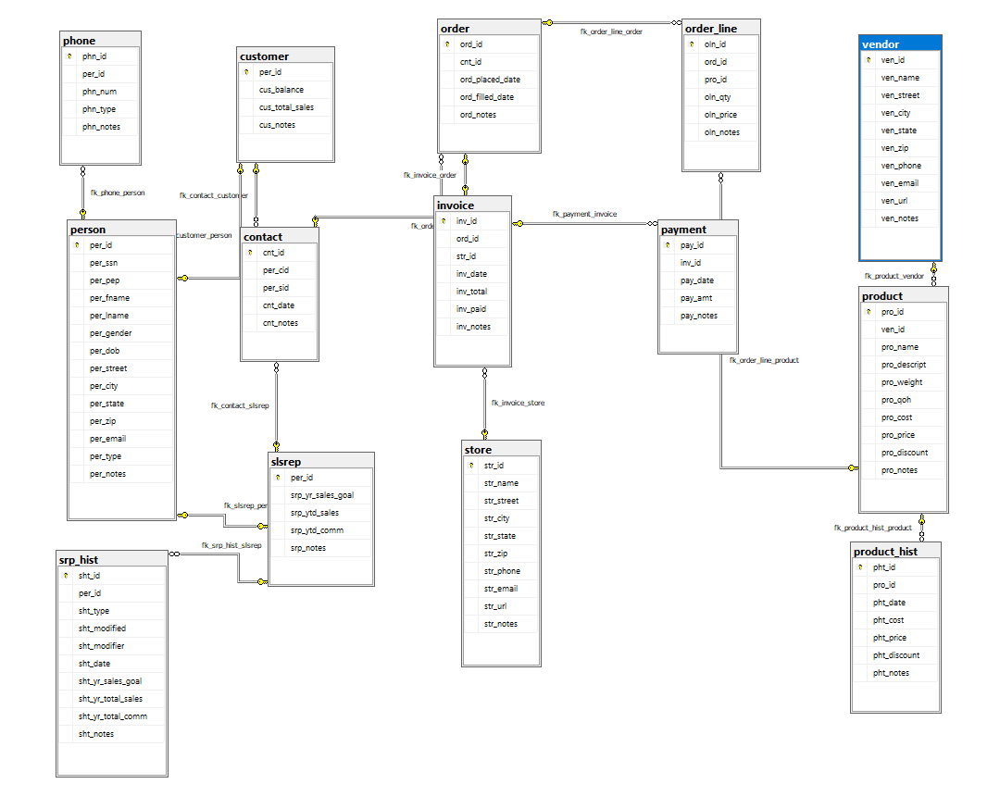
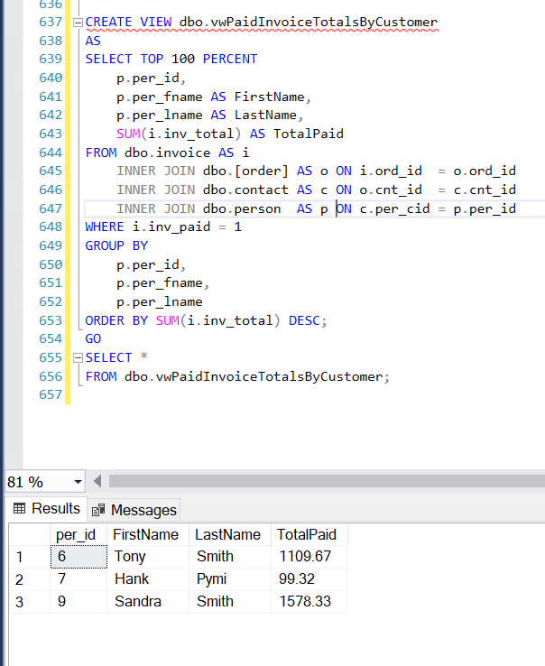

# LIS3781 Advanced Database Management  

## Brennan O'Halloran  

### Assignment #4 Requirements  

---  

**Five Parts:**

1. Create Assignment 4 ERD.
2. Create Assignment 4 SQL code.
3. Populate tables with data.
4. Attach required screenshots.
5. Attach required SQL code.

---

### README.md Requirements  

✔️ **Screenshot of your ERD**  
✔️ **Screenshot of one required report**   
✔️ **Link to lis3781_p1_solutions.sql file with tables and data**  

---

### Assignment Screenshots!  

---

#### **ERD**   
  

##### **Required Report**  
  

#### **Solution File**  
📄 [**View lis3781_A4_solutions.sql**](lis3781_a4_solutions.sql)  
