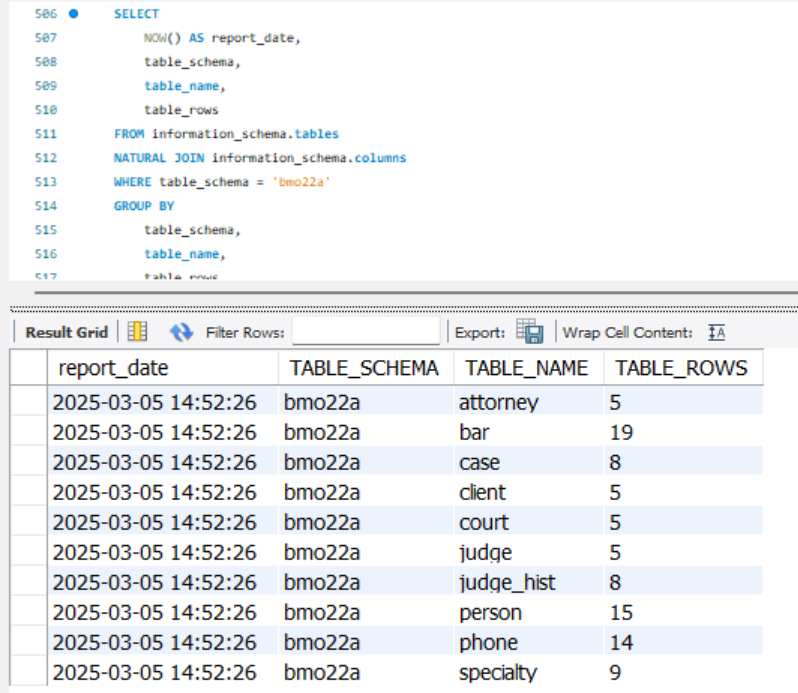
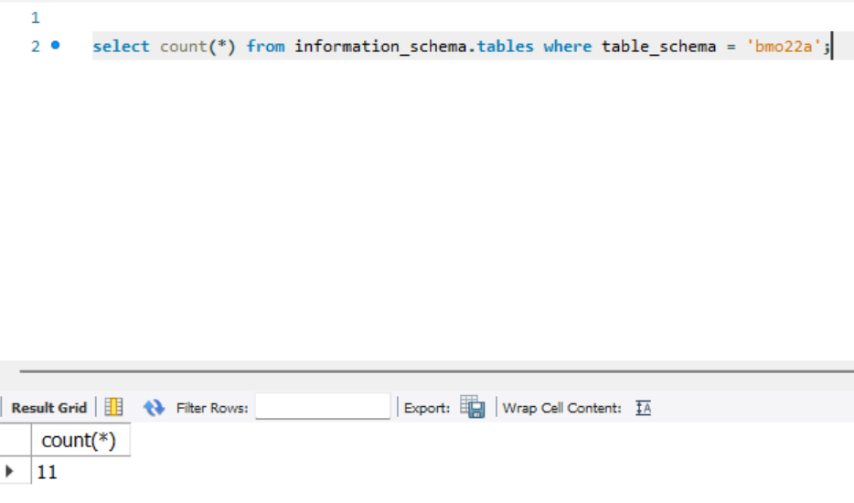
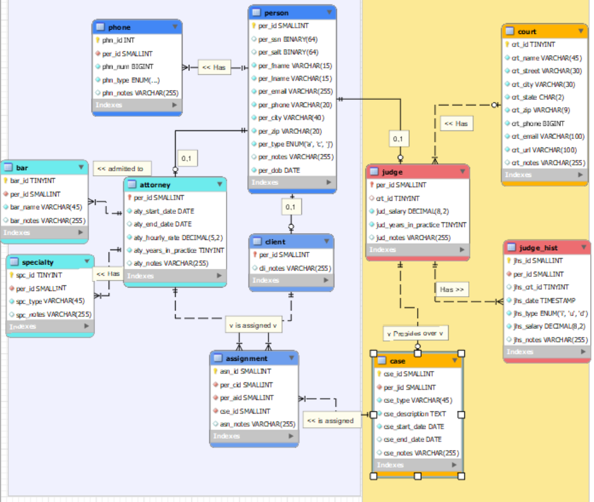
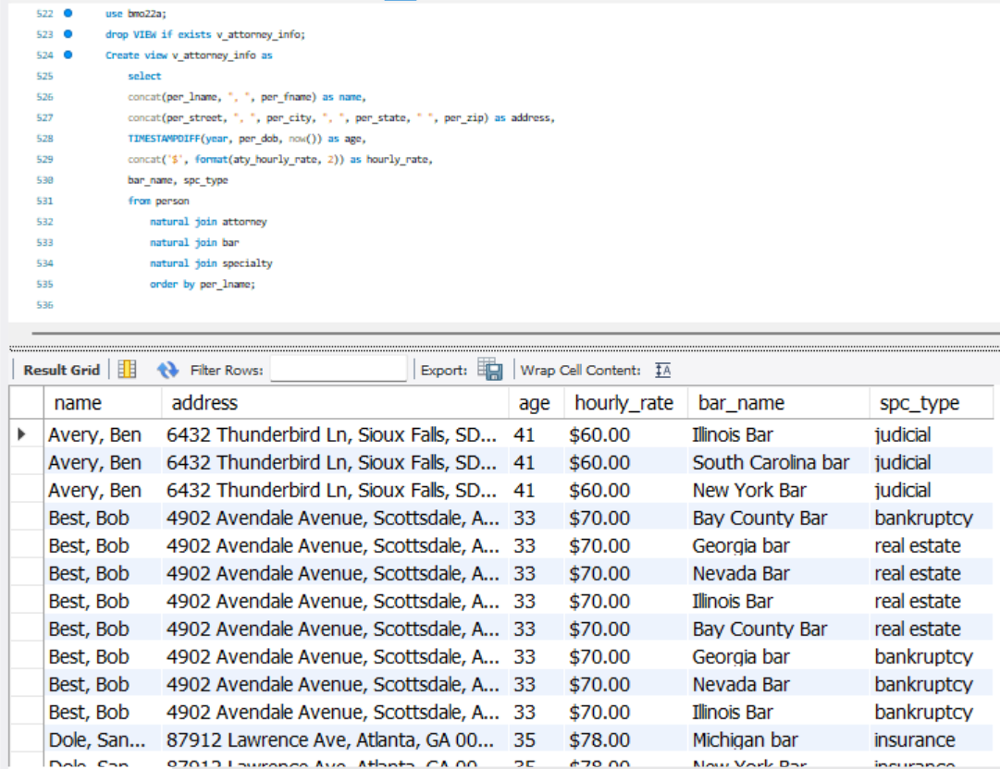

# LIS3781 Advanced Database Management  

## Brennan O'Halloran  

### Project #1 Requirements  

---  

**Four Parts:**

1. Create Project 1 ERD.
2. Create Project 1 SQL code.
3. Populate tables with data.
4. Attach required screenshots.
5. Attach required SQL code.

---

### README.md Requirements  

✔️ **Screenshot of your ERD**  
✔️ **Screenshot of number of tables (11)**  
✔️ **Screenshot of populated tables (11)**  
✔️ **Screenshot: At least *one* required report (i.e., exercise below), and SQL code solution** 
✔️ **Link to lis3781_p1_solutions.sql file with tables and data**  

---

### Assignment Screenshots!  

---

#### **Populated Tables**   
  

##### **Number of Tables**  
  

##### **P1 ERD**  
  

##### **Required Report Question #1:**  
  

#### **Solution File**  
📄 [**View lis3781_P1_solutions.sql**](lis3781_p1_solutions.sql)  
